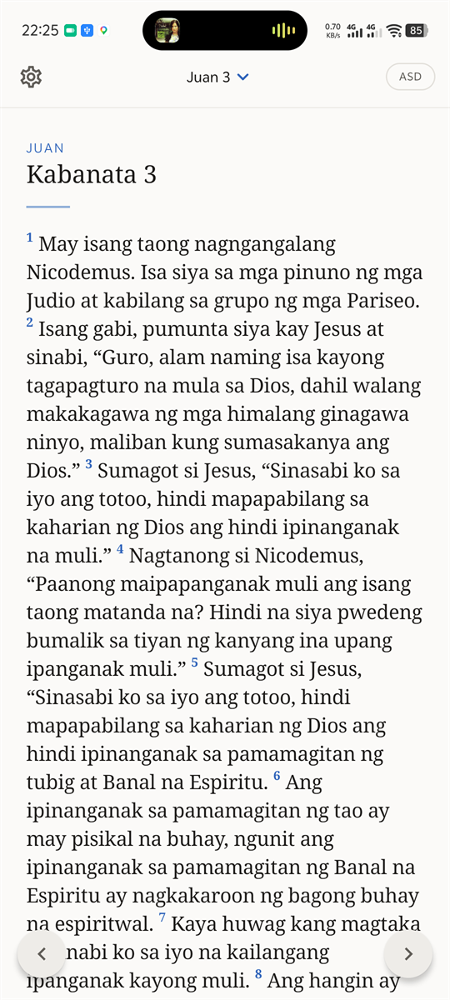
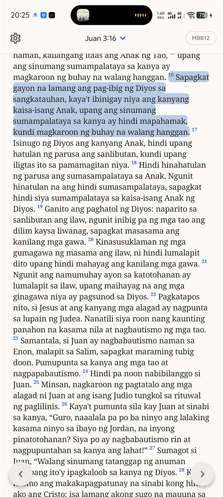
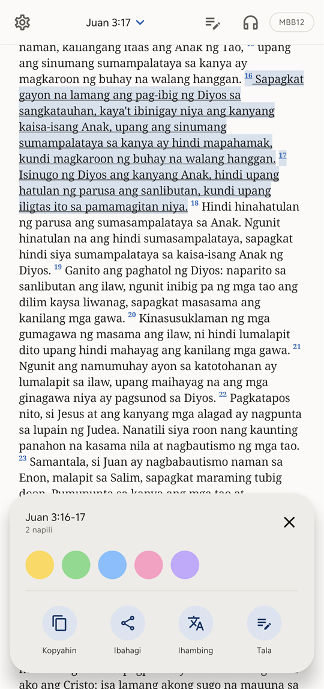
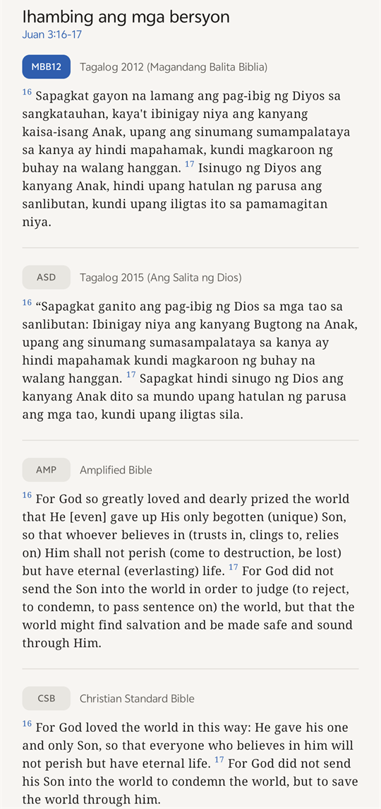
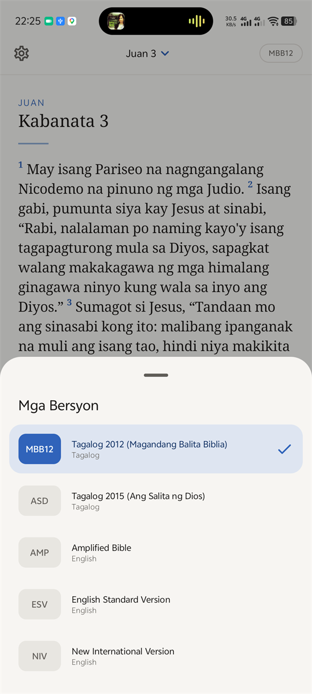
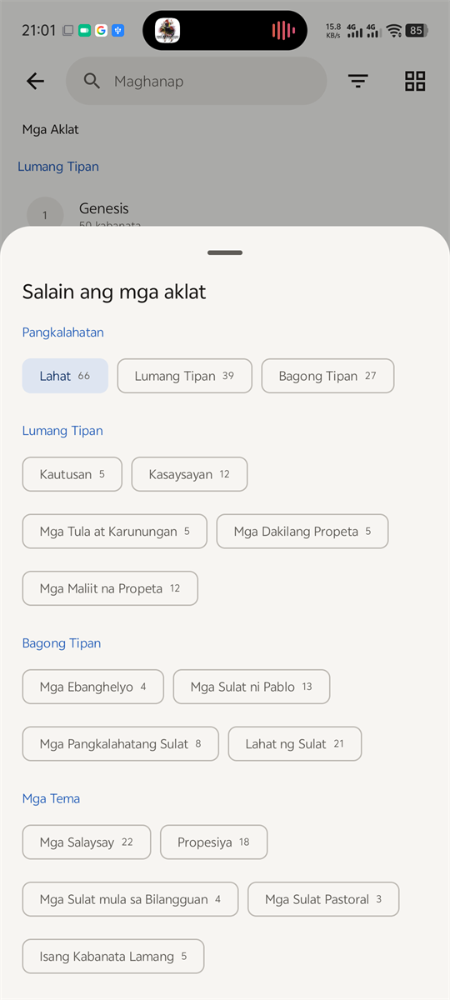
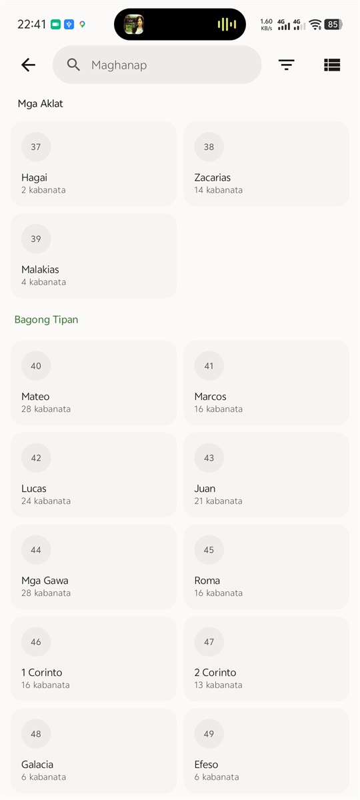
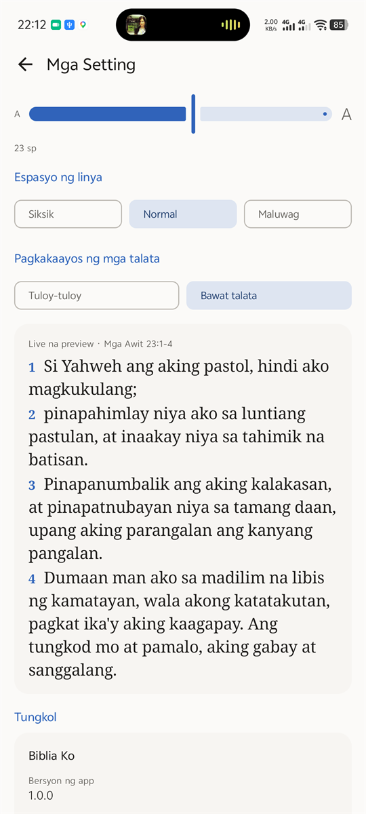

<div align="center">

# Biblia Ko

**An offline Tagalog & English Bible for Android: fast, clean, and built for daily reading.**

[](../../releases/latest)


</div>

<p align="center">
  
  
  
  
</p>

Biblia Ko works **completely offline**. It needs no account and no internet, and asks for **no permissions** (internet, storage, location, and so on). It bundles ten translations (two Tagalog, eight English), searches across the whole Bible quickly, opens any verse instantly, and can **read the Bible aloud** in Tagalog or English using your phone's built-in offline voices.

## Features

### Reading
- **Ten Bible versions** in Tagalog and English, switchable at any time. The reader **stays on the verse you are reading** when you switch.
- **Swipe between chapters**, or use the page arrows. Your place is remembered between sessions.
- **Combined verses are labelled as ranges.** Where a translation merges verses (common in the Tagalog versions), the reader shows e.g. Ruth 1:**1-2**. References, highlights, Compare and Listen all use the full range.
- **Two verse layouts:** a flowing *Paragraph* or *Verse by verse*, each verse on its own line.
- Serif reading font, adjustable **font size** and **line spacing**, with live previews in Settings.

### Listen (read aloud, offline)
- Tap the **headphones** button to have the Bible read aloud, verse by verse, using your phone's own text-to-speech. It works **without internet**: only installed, offline voices are ever used.
- The **voice follows the Bible version**: Tagalog versions are read in Filipino (fil-PH), English versions in English (en-US). Switching versions while listening continues from the same verse in the new voice.
- The verse being read is **highlighted and scrolled into view**. Reading continues into the next chapter and book until you stop it. Empty verses are skipped.
- A floating player has **previous/next verse, play/pause and stop**. Reading pauses when headphones are unplugged or a call comes in, and resumes after the call.
- **Settings → Listen:** speed (0.75×–1.5×), pitch, a voice picker per language (offline voices only), *read verse numbers*, a **Test voice** button, and a **Voice status** row per language: *Installed offline*, *Needs download* or *Engine missing*.
- If a voice is missing, a guided dialog (in Filipino) explains how to install it, with buttons that open the voice installer and the phone's Text-to-speech settings. Other languages keep working.

### Search & navigation
- **Type a reference and jump straight to it:** `juan 3:16`, `john 3:16`, `1 cor 13`, `awit 23`. The verse is scrolled into view and briefly highlighted.
- **Full-text search** across the Bible, accent- and case-insensitive, with matches highlighted in each result. Exact phrases are listed first, and hyphenated Tagalog words are found however you type them: *pag-ibig*, *pag ibig* or *pagibig*.
- **Book filters** grouped by Old Testament, New Testament and themes: Law, Gospels, Paul's Letters, Prophecy, Prison Letters, One-Chapter Books, and more.
- Browse books → chapters → verses as a **list or a grid**.

### Verse tools
Tap any verse to open the verse panel:
- **Highlight** in five colours. Highlights are saved per verse and show in every translation.
- **Copy** or **Share** with a formatted reference, e.g. *"…" – Juan 3:16-17 (MBB12)*.
- **Compare** the selected verses side by side in every installed version.
- **Notes:** write a personal note, prayer or reflection on one or more verses. A small note icon marks noted verses in the reader; tap it to read or edit the note. Like highlights, notes show in every translation.
- **All your notes in one place:** the notebook button in the reader opens a searchable list of your notes, sorted by newest or in Bible order. Open a note to edit it, share it, or jump straight to its verse.

### Personalisation
- **Seven themes:** System, Light, Sepia, Sage, Dark, Slate, and Midnight (true black for OLED screens).
- **Ten accent colours.** Each has a tone tuned separately for light and dark themes, and every combination is unit-tested for WCAG text contrast, including on top of highlights.
- **App language:** Tagalog, English, or *Follow the Bible*, which uses Tagalog for Tagalog versions and English for English ones. Book names follow the selected Bible's language.
- **App size:** make the whole app bigger or smaller (80%–130%), independent of the phone's display-size setting.
- **Three home-screen icons** to choose from: Sunrise, Night and Sky.

### Backup & transfer
- **Export** your settings, highlights and notes to a file (Downloads, Google Drive, …) and **import** it on another phone. Importing only adds: nothing is deleted, and importing the same file twice is harmless. No storage permission is needed.

<p align="center">
  
  
  
  
</p>

## Download & install

1. Download **`BibliaKo-v2.4.0.apk`** from the [latest release](../../releases/latest).
2. Open it on your phone. If asked, allow your browser or file manager to *install unknown apps*.
3. On first launch the app prepares the default Bible (a few seconds). Every other version is prepared the first time you select it.

**Requirements:** Android 7.0 (API 24) or newer, and about 100 MB of free storage once all ten versions are installed (roughly 8 MB per version). Reading aloud uses the phone's text-to-speech engine (for example *Speech Services by Google*, preinstalled on most phones) with a downloaded offline voice for each language.

> The release APK is signed with a development key for direct installation. It is not distributed through Google Play.

## Bible versions

| | Version | Language | Copyright |
|---|---|---|---|
| **MBB12** | Magandang Balita Biblia (2012) | Tagalog | New Testament © 2012, Old Testament © 2005 Philippine Bible Society |
| **ASD** | Ang Salita ng Dios (2015) | Tagalog | © 2009, 2011, 2014, 2015 Biblica, Inc. |
| **AMP** | Amplified Bible | English | © 2015 The Lockman Foundation |
| **CSB** | Christian Standard Bible | English | © 2017 Holman Bible Publishers |
| **ESV** | English Standard Version | English | © 2001 Crossway Bibles (Text Edition 2016) |
| **HCSB** | Holman Christian Standard Bible | English | © 2004 Holman Bible Publishers |
| **KJV** | King James Version | English | Public domain |
| **NIV** | New International Version | English | © 1973, 1978, 1984, 2011 Biblica, Inc. |
| **NKJV** | New King James Version | English | © 1982 Thomas Nelson |
| **NLT** | New Living Translation | English | © 1996, 2004, 2015 Tyndale House Foundation |

All Bible texts remain the property of their respective copyright holders.

## Tech stack

| Area | Technology |
|---|---|
| Language | Kotlin 2.0 |
| UI | Jetpack Compose, Material 3, Navigation Compose |
| Storage | Room (SQLite) with an **FTS4** full-text index; Preferences DataStore |
| Concurrency | Kotlin Coroutines & Flow |
| Read aloud | Android `TextToSpeech` (on-device voices only), audio focus |
| Architecture | MVVM, manual dependency injection (`AppContainer`) |
| Build | Gradle 8.13 (Kotlin DSL), AGP 8.13, KSP, R8 minification |

### How it works

- **Import:** each version ships as XML in `app/src/main/assets/bibles/`. On first use it is streamed through an `XmlPullParser` and inserted into Room in batches, together with that version's own accent-folded FTS4 search index. The import's temporary copy is deleted afterwards.
- **Fast navigation:** the reader pages over a flat index of all 1,189 chapters. Jumping to a verse first loads the target chapter into a shared in-memory cache, so the reader's first frame already shows the text.
- **Fast, compact search:** each version has its own lean full-text index that stores no second copy of the text. Results come back in Bible order straight from the index and stop at the result limit, so even very common words return in well under a second.
- **Read aloud:** a pure-Kotlin `TtsController` queues one verse at a time and follows the reader across chapters and books. The Android speech engine and audio focus sit behind small interfaces, so the logic is unit-tested on the JVM, including offline-voice selection and missing-engine handling.
- **Your data is kept separate:** highlights and notes live in their own database (`user.db`) and can be exported to a JSON backup, so updating or re-importing a Bible never touches them. Schema changes there always use a real migration.

## Building from source

**Prerequisites:** JDK 17 and the Android SDK (platform 35). Point `local.properties` at your SDK:

```properties
sdk.dir=C\:\\path\\to\\Android\\Sdk
```

```bash
./gradlew assembleDebug          # debug APK  -> app/build/outputs/apk/debug/
./gradlew assembleRelease        # release APK -> app/build/outputs/apk/release/
./gradlew :app:testDebugUnitTest # unit tests (86)
```

On Windows, use `gradlew.bat`. To run a single test class:

```bash
./gradlew :app:testDebugUnitTest --tests "com.example.biblia.ThemeContrastTest"
```

### Project structure

```
app/src/main/java/com/example/biblia/
├── data/        Room databases, XML import, repositories, version registry, app-icon switching
├── di/          AppContainer (manual DI) and the reader navigation bus
├── domain/      Models, reference parsing/formatting, book & full-text search logic
└── ui/          Compose screens: reader, selection (books/chapters/verses/search), settings, theme
app/src/main/assets/bibles/   Bundled Bible XML files
design/icons/                 Source artwork for the launcher icons
```

### Adding a Bible version

1. Put the XML (same `<bible><testament><book><chapter><verse>` schema) in `app/src/main/assets/bibles/`.
2. Add one `BibleVersion` entry to `data/BibleVersionRegistry.kt` with its name, language and copyright notice.

Import, search, comparison and the About screen pick it up automatically.

## Developer

Designed and developed by **Jee.**

## License

No open-source license is granted for this repository; all rights reserved by the developer. The Bible texts are copyrighted by their respective publishers (see [Bible versions](#bible-versions)) and are not covered by any license here.
